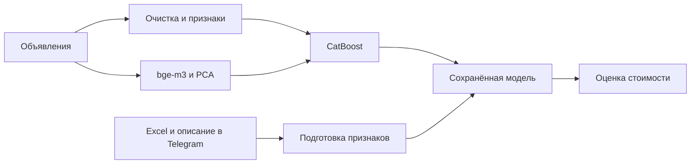

# PriceVision / Flat Inspector

**End-to-end ML-сервис для оценки стоимости квартир в Москве по параметрам объявления и текстовому описанию.**

Рабочий прототип, самостоятельно разработанный Рузелем Салиховым в рамках
ML-акселератора Газпромбанка × Финансового университета (февраль — май 2026).
Программа включала конкурсный отбор и работу с наставниками; проект не является
коммерческим внедрением или опытом трудоустройства в банке.

**Мой вклад:** сбор данных, EDA, feature engineering, эксперименты с CatBoost и
текстовыми признаками, Optuna, DVC и Telegram-интерфейс на aiogram.

[Пример работы бота](docs/bot_demo.md) · [Эксперименты](notebooks/model+tuning.ipynb)



---

## Что умеет проект

* Собирает и обрабатывает данные по объявлениям о недвижимости.
* Выполняет EDA и feature engineering для табличных признаков.
* Использует CatBoostRegressor для предсказания стоимости квартиры.
* Добавляет текстовые признаки из описания объявления через sentence-transformer модель `BAAI/bge-m3`.
* Снижает размерность текстовых эмбеддингов через PCA.
* Подбирает гиперпараметры модели с помощью Optuna.
* Выдает предсказание стоимости через Telegram-бота.
* Позволяет пользователю загрузить Excel-шаблон с параметрами квартиры, выбрать категориальные признаки и добавить текстовое описание.

---

## Результаты модели

Результаты сохранены в [ноутбуке обучения](notebooks/model+tuning.ipynb).
R² рассчитывается для `log1p(price)`, MAE и MAPE — для цены после `expm1`.

| Эксперимент | R² для log(price) | MAE, млн ₽ | MAPE |
| --- | ---: | ---: | ---: |
| CatBoost, табличные признаки | 0.9128 | 9.29 | 15.82% |
| CatBoost + текстовые признаки CatBoost | 0.9243 | 8.63 | 14.55% |
| CatBoost + bge-m3 / PCA | 0.9274 | 8.48 | 14.26% |
| bge-m3 / PCA + Optuna | 0.9340 | 8.10 | 13.25% |

Первые три строки — среднее по 10 фолдам (`KFold`, shuffle, seed 42).
Последняя — результат на 20% validation после 50 Optuna trials. Эти строки
используют разные схемы оценки, поэтому разницу нельзя целиком приписать тюнингу.

**Ограничения оценки:** PCA обучался на всей выборке до разбиения; validation
использовалась для early stopping и подбора гиперпараметров; независимый итоговый
test не выделен. Для строгой оценки нужно обучать PCA внутри каждого train-fold
и отдельно проверить модель на отложенной выборке. Разбиение при тюнинге не имеет
фиксированного `random_state`. Приведённые цифры — результаты исходного эксперимента,
а не гарантия качества на новых объявлениях.

---

## Стек

**ML / Data:**

* Python
* Pandas
* NumPy
* Scikit-learn
* CatBoost
* Optuna
* Sentence Transformers
* PCA

**Engineering / Tools:**

* DVC
* uv
* pyproject.toml
* aiogram
* Telegram Bot API
* Google Colab / Kaggle
* dotenv

---

## Структура проекта

```text
Gazprom_project/
├── data/                    # данные и DVC-артефакты
├── notebooks/
│   ├── EDA.ipynb
│   ├── Feature Engineering.ipynb
│   └── model+tuning.ipynb
├── src/
│   ├── parser/              # сбор и парсинг данных
│   └── preprocessing/       # обработка и подготовка признаков
├── tg_bot/
│   ├── models/              # CatBoost, PCA и датасет статистик
│   └── bot.py               # Telegram-интерфейс для инференса модели
├── .dvc/
├── pyproject.toml
├── uv.lock
└── README.md
```

---

## Как работает Telegram-бот

1. Пользователь запускает бота.
2. Бот отправляет Excel-шаблон для заполнения параметров квартиры.
3. Пользователь загружает заполненный файл.
4. Бот просит выбрать категориальные признаки: район, тип квартиры, ремонт, парковку, тип дома.
5. Пользователь может добавить текстовое описание квартиры.
6. Модель формирует признаки, добавляет текстовые эмбеддинги и предсказывает цену.
7. Бот возвращает оценку стоимости квартиры и краткое пояснение.

---

## ML-пайплайн

1. **Data collection:** сбор объявлений и характеристик недвижимости.
2. **EDA:** анализ распределений, пропусков, выбросов и целевой переменной.
3. **Feature engineering:** создание признаков: возраст дома, площадь на комнату, отношение этажа к этажности, доли кухни/жилой площади и другие.
4. **Text embeddings:** преобразование описаний объявлений в эмбеддинги через `BAAI/bge-m3`.
5. **Dimensionality reduction:** PCA для сокращения размерности эмбеддингов.
6. **Modeling:** CatBoostRegressor для табличных и категориальных признаков.
7. **Tuning:** подбор гиперпараметров через Optuna.
8. **Deployment:** инференс модели через Telegram-бота.

---

## Ограничения

* Индивидуальный интервал неопределённости не рассчитывается; общая метрика R² не является уверенностью в цене конкретной квартиры.
* Модель оценивает квартиры в Москве и может хуже работать на объектах из других регионов.
* Качество предсказания зависит от полноты введенных параметров.
* MAE в рублях высокий из-за большой вариативности цен на московскую недвижимость, поэтому дополнительно используется MAPE.
* Telegram-бот использует заранее обученную модель и вспомогательные артефакты: CatBoost model, PCA model, датасет для заполнения пропусков и sentence-transformer модель.


## Как запустить проект

Проект можно запустить локально для просмотра ноутбуков, воспроизведения пайплайна и запуска Telegram-бота для инференса модели.

### 1. Клонировать репозиторий

```bash
git clone https://github.com/Ruzik707/Gazprom_project.git
cd Gazprom_project
```

### 2. Установить зависимости

Проект использует `uv` и `pyproject.toml` для управления зависимостями.

```bash
uv sync
```

Если `uv` не установлен, зависимости можно установить вручную через `pip` на основе `pyproject.toml`.

```bash
pip install -e .
```

Рекомендуемая версия Python: **3.12+**.

### 3. Создать файл окружения

Скопируйте пример файла окружения:

```bash
cp .env.example .env
```

Затем откройте `.env` и укажите свои значения:

```env
BOT_TOKEN=your_telegram_bot_token

MODEL_PATH=tg_bot/models/best_model.cbm
PCA_PATH=tg_bot/models/pca_model.pkl
DATASET_PATH=tg_bot/models/clean_dataset.parquet
TEMPLATE_PATH=docs/Шаблон.xlsx

EMB_MODEL_NAME=BAAI/bge-m3
```

`BOT_TOKEN` можно получить через BotFather в Telegram.

### 4. Подготовить артефакты модели

Бот использует следующие пути по умолчанию, совпадающие с `.env.example`:

```text
tg_bot/models/
├── best_model.cbm
├── pca_model.pkl
└── clean_dataset.parquet
docs/Шаблон.xlsx
```

Эти файлы отслеживаются в текущем репозитории. Если в вашей копии они отсутствуют,
нужны совместимые артефакты из эксперимента обучения; одних пустых директорий
недостаточно. Пути можно изменить через `.env`. Модель `BAAI/bge-m3` загружается
отдельно при первом старте и требует доступа к хранилищу моделей.

Данные, отслеживаемые DVC, загружаются через `uv run dvc pull` при наличии доступа
к remote. Учётные данные хранятся только локально: [настройка DVC](docs/credentials.md).

### 5. Запустить Telegram-бота

После настройки `.env` и добавления артефактов можно запустить бота:

```bash
uv run python tg_bot/bot.py
```

При успешном запуске бот загрузит:

* CatBoost-модель;
* PCA-модель;
* sentence-transformer модель `BAAI/bge-m3`;
* очищенный датасет для вычисления статистик и заполнения пропусков.

После этого бот начнет принимать сообщения в Telegram.

### 6. Как пользоваться ботом

1. Откройте Telegram-бота.
2. Нажмите `/start`.
3. Выберите действие **“Оценить квартиру”**.
4. Скачайте Excel-шаблон.
5. Заполните параметры квартиры: количество комнат, площадь, этаж, этажность и другие характеристики.
6. Отправьте заполненный Excel-файл обратно боту.
7. Выберите категориальные признаки: район, тип квартиры, ремонт, парковку и тип дома.
8. При желании добавьте текстовое описание квартиры.
9. Бот сформирует признаки, рассчитает текстовые эмбеддинги и вернет прогноз стоимости квартиры.

### 7. Запуск ноутбуков

Основные этапы проекта находятся в папке `notebooks/`:

```text
notebooks/
├── EDA.ipynb
├── Feature Engineering.ipynb
└── model+tuning.ipynb
```

Они показывают полный ML-пайплайн:

1. анализ данных;
2. обработку признаков;
3. feature engineering;
4. обучение CatBoostRegressor;
5. подбор гиперпараметров через Optuna;
6. оценку качества модели.

Для запуска ноутбуков можно использовать Jupyter:

```bash
uv run --with jupyter jupyter notebook
```

или открыть их в VS Code / PyCharm / Google Colab.

### 8. Важное замечание

Для полноценного запуска Telegram-бота нужны локальные артефакты модели и данных. Без файлов `best_model.cbm`, `pca_model.pkl`, `clean_dataset.parquet` и `docs/Шаблон.xlsx` бот не сможет выполнить инференс.
