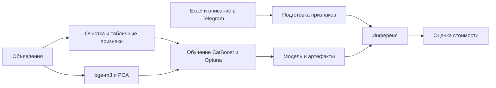

# PriceVision — оценка стоимости квартир в Москве

ML-прототип, который объединяет параметры квартиры и текст объявления,
предсказывает стоимость с помощью CatBoost и возвращает результат в Telegram.

**Контекст:** ML-акселератор Газпромбанка × Финансового университета,
конкурсный отбор и наставничество, февраль — май 2026.
**Мой вклад:** самостоятельно реализовал сбор данных, EDA, feature engineering,
модельные эксперименты, подбор параметров, DVC и Telegram-интерфейс.
Проект остался рабочим прототипом программы.

**Стек:** Python, Pandas, CatBoost, Optuna, Sentence Transformers (`BAAI/bge-m3`),
PCA, DVC / S3, aiogram.

[Демо бота](docs/bot_demo.md) · [Обучение и сравнение моделей](notebooks/model+tuning.ipynb) ·
[Код инференса](tg_bot/bot.py) · [Запуск](#запуск)

## Результаты экспериментов

Результаты сохранены в [ноутбуке обучения](notebooks/model+tuning.ipynb).
R² рассчитывается для `log1p(price)`, MAE и MAPE — для цены после `expm1`.

| Эксперимент | R² для log(price) | MAE, млн ₽ | MAPE |
| --- | ---: | ---: | ---: |
| CatBoost, табличные признаки | 0.9128 | 9.29 | 15.82% |
| CatBoost + текстовые признаки CatBoost | 0.9243 | 8.63 | 14.55% |
| CatBoost + bge-m3 / PCA | 0.9274 | 8.48 | 14.26% |
| bge-m3 / PCA + Optuna | 0.9340 | 8.10 | 13.25% |

Первые три строки — среднее по 10 фолдам (`KFold`, shuffle, seed 42).
Последняя — результат на 20% validation после 50 Optuna trials. Эти строки
используют разные схемы оценки, поэтому разницу нельзя целиком приписать тюнингу.

**Ограничения оценки:** PCA обучался на всей выборке до разбиения; validation
использовалась для early stopping и подбора гиперпараметров; независимый итоговый
test не выделен. Для строгой оценки нужно обучать PCA внутри каждого train-fold
и отдельно проверить модель на отложенной выборке. Разбиение при тюнинге не имеет
фиксированного `random_state`. Приведённые цифры — результаты исходного эксперимента,
а не гарантия качества на новых объявлениях.


## Как устроено



Пользователь получает Excel-шаблон, загружает параметры, выбирает категориальные
признаки и добавляет описание. Бот формирует те же группы признаков, что при
обучении, получает прогноз `log1p(price)` и переводит его в рубли через `expm1`.

| Где смотреть | Этап |
| --- | --- |
| [src/parser/](src/parser/) | сбор объявлений |
| [src/preprocessing/](src/preprocessing/) | очистка и подготовка |
| [notebooks/EDA.ipynb](notebooks/EDA.ipynb) | исследование данных |
| [notebooks/Feature Engineering.ipynb](<notebooks/Feature Engineering.ipynb>) | инженерия признаков |
| [notebooks/model+tuning.ipynb](notebooks/model+tuning.ipynb) | baseline, текстовые признаки, Optuna и метрики |
| [tg_bot/bot.py](tg_bot/bot.py) | FSM-сценарий, заполнение пропусков и инференс |

## Запуск

Python 3.12+, менеджер зависимостей uv. Из корня проекта:

```bash
git clone https://github.com/Ruzik707/Gazprom_project.git
cd Gazprom_project
uv sync
cp .env.example .env
```

В `.env` задайте `BOT_TOKEN`. Пути по умолчанию совпадают с `.env.example`:

```text
tg_bot/models/best_model.cbm
tg_bot/models/pca_model.pkl
tg_bot/models/clean_dataset.parquet
docs/Шаблон.xlsx
```

Эти артефакты отслеживаются в текущем репозитории. Модель `BAAI/bge-m3`
загружается отдельно при первом запуске. Для DVC-данных нужен доступ к remote;
учётные данные задаются [локально](docs/credentials.md).

```bash
uv run python tg_bot/bot.py
```

Откройте бота в Telegram → «Оценить квартиру» → заполните выданный Excel-шаблон →
выберите признаки → добавьте описание → получите оценку.
Ноутбуки можно изучить на GitHub или открыть через `uv run --with jupyter jupyter notebook`.

## Ограничения

- Модель обучена на московских объявлениях; перенос на другие регионы не проверялся.
- Результат зависит от полноты параметров, сдвига цен и распределения новых объектов.
- Индивидуальный интервал неопределённости не рассчитывается. Общий R² не является
  уверенностью в прогнозе конкретной квартиры.
- Условия исходной валидации описаны выше; строгая итоговая оценка требует отдельного test.
- [Скриншоты](docs/bot_demo.md) показывают историческую версию прототипа;
  текущий текст ответа и формулировки метрик уточнены в коде и этом README.
